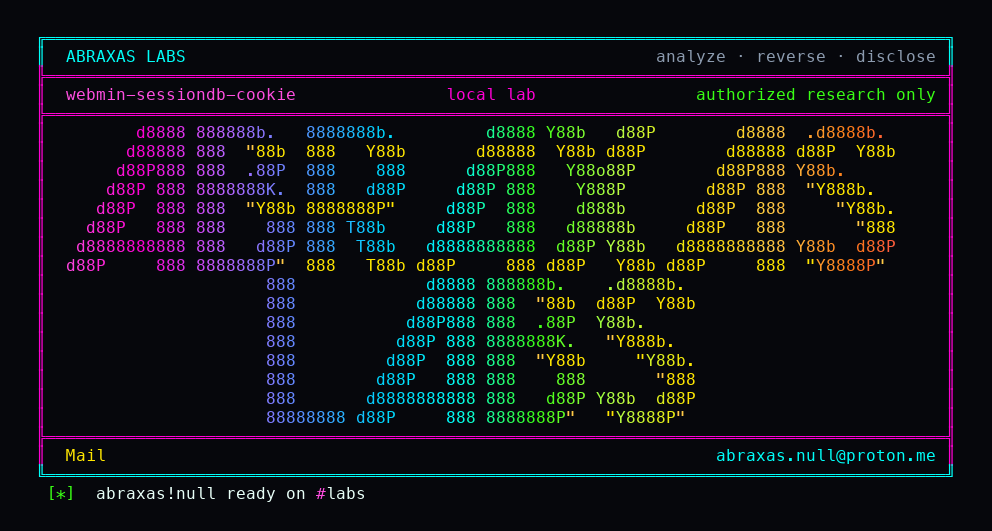

<p align="center">
  
</p>

# webmin-sessiondb-cookie

Webmin will let you give someone the Webmin Users page that lists who is signed in, and separately refuse them the switch-user grant. That split is the product. The list page still prints a hex string next to every live login. That string is the session database key. miniserv will take it as the `sid` cookie. A coworker who was only supposed to see and cancel sessions becomes whoever is on the list, including the root Webmin user.

I planted `sessions=1` and `switch=0` on a second login, confirmed switch stayed denied, copied root's key off the HTML, and put it in a cookie. I was root. `session_ip` was not in miniserv.conf. That is the default.

**Class:** Session theft
**Reach:** Remote (signed-in user with acl `sessions=1`, `switch=0`)

**Webmin** `2.670` (`3a2b2b86`) - webmin/webmin

| | |
|---|---|
| ID | no CVE yet |
| Class | **Session theft** (printed sessiondb key is a live cookie) |
| Reach | **Remote** (signed-in; `sessions=1`; `switch` denied) |
| CWE | [CWE-287](https://cwe.mitre.org/data/definitions/287.html) |
| CVSS | **Critical: 9.1** `CVSS:3.1/AV:N/AC:L/PR:L/UI:N/S:U/C:H/I:H/A:N` |
| Product | [Webmin](https://github.com/webmin/webmin) |
| Affected | **2.670** tag `2.670` (`3a2b2b8671c0669c129f5275b3dd1853106ae02b`) |
| Auth | cookie login; Webmin Users module; `sessions=1`; `switch=0`; a second live session to steal |
| License | [GNU Affero GPL v3.0](LICENSE) |
| Lab | loopback `127.0.0.1:18440`. Compose `webminh27`. Two logins. |

## What an attacker can do

Needs a signed-in Webmin user who was given the Webmin Users module and the `sessions` ACL, and who was denied `switch`. In ordinary words: the helpdesk grant that is supposed to show who is logged in, not become them. Root, or anyone else with a live session, has to be signed in at the same time. The attacker does not need the victim's password.

| Privilege | Method / sink | Recon / integrity / availability | Lab-proven or inferred |
|---|---|---|---|
| Confirm `session_ip` is off | `miniserv.conf` has no `session_ip=` after `setup.sh` | Recon | Lab-proven. `session_ip=off` |
| Confirm the planted ACL | `acl/limited.acl` `users=~` `sessions=1` `switch=0` | Recon | Lab-proven |
| Switch into root stays denied | `GET /acl/switch.cgi?user=root` as limited | n/a (negative) | Lab-proven. `You are not allowed to switch to this user` |
| Edit root as limited stays denied | `GET /acl/edit_user.cgi?user=root` as limited | n/a (negative) | Lab-proven. `You are not allowed to edit this user` |
| Read every live sessiondb key, including root | `GET /acl/list_sessions.cgi` prints `<tt>$k</tt>` | Recon (session secret) | Lab-proven. 64-char HMAC hex |
| Become that user by sending the printed key as the cookie | `Cookie: sid=<sessiondb key>` against miniserv `verify` | Integrity (authn) | Lab-proven. `edit_user.cgi?user=root` as root |
| Act as root for the life of that session | Same stolen cookie on later module CGIs | Integrity / recon of root's modules | Inferred from the stolen identity. Lab showed the Users editor as root |

**Stays closed on this leftover**

| Axis | Method / sink | Why it is closed |
|---|---|---|
| Integrity | `GET /acl/switch.cgi` | Still needs `can_edit_user` and `access{'switch'}`. Lab denied it |
| Integrity | `GET /acl/edit_user.cgi?user=root` as the limited login | `users=~` only matches self |
| Integrity | Unauthenticated caller | Needs a signed-in `sessions=1` user and a second live session |
| Integrity | New session insert | `new` stores under `hash_session_id($cookie)`, not the raw cookie |
| Integrity | Session DB and HMAC key files | Created mode 0600. This leftover is the HTML, not the files |
| Integrity | Shipped `admin` / `admin` | `setup.bat` only. rpm/deb postinst sets `crypt=x` |
| Availability | Killing other sessions | `delete_session.cgi` is the intended `sessions=1` grant, not this leftover |

The HMAC on insert is real. The parser still accepts the stored key if you send it. That is the mismatch. A second class note on the same two lines was the same bug, not a second issue.

## How I found it

I was reading the Webmin Users module for a grant that was denied on paper and still reached a sink. `switch.cgi` does what the ACL says. `list_sessions.cgi` only checks `sessions`. Line 57 prints `$k`. `$k` is the DBM key.

New logins go in under HMAC-SHA256 of the cookie (`miniserv.pl` `new` handler). The `verify` handler does `$sessiondb{$session_id} ? $session_id : hash_session_id($session_id)`. If the cookie is already a key, hashing is skipped. The cookie regex is `[a-f0-9]+`. A 64-char hex HMAC matches. `session_ip` is a checkbox that is off unless someone turns it on, so the stolen key works from another client.

Wrong turns, in order: treating the `<tt>` as a display id that still had to be HMAC'd before it would verify; treating `switch.cgi` as the only impersonation path; assuming `session_ip` was on because the UI exists; filing the verify-handler note as a second leftover.

## Lab

```bash
python3 webmin-sessiondb-cookie-Abraxas-Labs.py
```

or:

```bash
cd lab
./run.sh
```

Clones [webmin/webmin](https://github.com/webmin/webmin) tag `2.670` (`3a2b2b8671c0669c129f5275b3dd1853106ae02b`) into `lab/src` and reuses `webmin-lab:2.670` when present. Loopback only. Two logins: `root` / `labroot` and a planted `limited` user.

```text
IOC limited-acl users=~ sessions=1 switch=0
IOC session_ip session_ip=off
IOC switch.cgi status=200 denied
IOC edit_user root-as-limited denied=1
IOC stolen-key len=64
IOC replay status=200
SUCCESS WEBMIN-H27-SESSIONDB list_sessions.cgi sid=sessiondb-key became-root WEBMIN-H27-SESSION-KEY
```

## The fix

Stop printing the sessiondb key. Give the UI a truncated handle that is not a lookup key. Make `verify` look up only `hash_session_id($cookie)` and refuse a cookie that is already a stored key. Keep `switch.cgi` as the only impersonation path. Turning `session_ip` on by default is a useful extra, not a substitute.

## References

- [github.com/webmin/webmin](https://github.com/webmin/webmin) tag [2.670](https://github.com/webmin/webmin/releases/tag/2.670) (`3a2b2b8671c0669c129f5275b3dd1853106ae02b`)
- [`acl/list_sessions.cgi`](https://github.com/webmin/webmin/blob/3a2b2b8671c0669c129f5275b3dd1853106ae02b/acl/list_sessions.cgi)
- [`miniserv.pl` verify handler](https://github.com/webmin/webmin/blob/3a2b2b8671c0669c129f5275b3dd1853106ae02b/miniserv.pl)
- [`miniserv-lib.pl` cookie parse](https://github.com/webmin/webmin/blob/3a2b2b8671c0669c129f5275b3dd1853106ae02b/miniserv-lib.pl)
- [`acl/switch.cgi`](https://github.com/webmin/webmin/blob/3a2b2b8671c0669c129f5275b3dd1853106ae02b/acl/switch.cgi)
- [CWE-287](https://cwe.mitre.org/data/definitions/287.html)
- [webmin.com/security](https://webmin.com/security/)

## License

GNU Affero GPL v3.0. See [LICENSE](LICENSE). Loopback lab only. No warranty.

Abraxas Labs
abraxas.null@proton.me
